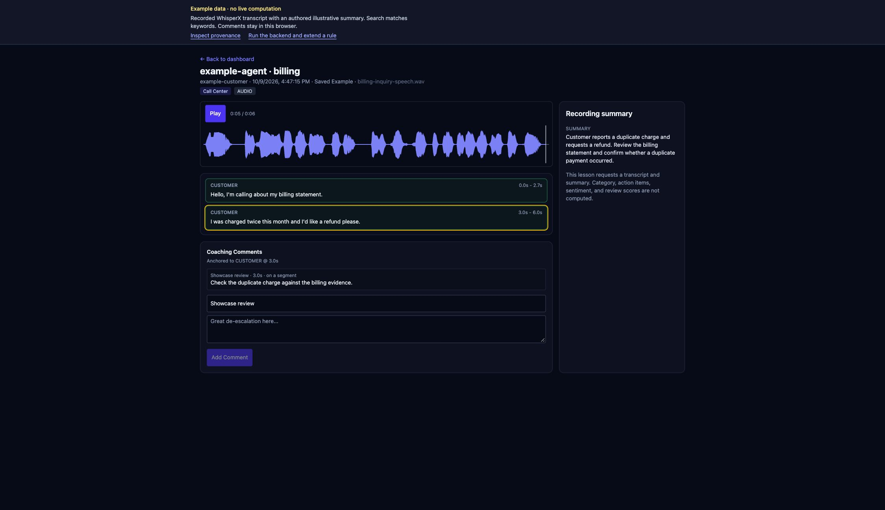

# Build call intelligence on Pixeltable

[](https://github.com/pixeltable/showcase-call-intelligence/actions/workflows/ci.yml)
[](LICENSE)

Build a call review app with transcripts, summaries, semantic search, and coaching comments tied to the recording.

Give your coding agent a backend it can extend. [Pixeltable](https://github.com/pixeltable/pixeltable) provides typed media, computed-column dependencies, vector indexing, and typed API routes; your Python code defines the product's rules.

## What you'll learn

- Declare media processing and model calls as stored computed columns.
- Change a review rule without rerunning transcription or losing comment anchors.
- Compare backend code and maintenance behind the same UI and REST contract.

## Try it

Requires Node.js 20+. The saved example needs no backend, keys, or model downloads.

```bash
git clone https://github.com/pixeltable/showcase-call-intelligence.git
cd showcase-call-intelligence
(cd frontend && npm ci && npm run demo)
```

Open **http://127.0.0.1:5176**. Play the recording, search "billing", and comment on a transcript segment. The transcript is recorded output; the summary is an authored illustration. Keyword search and comments run in your browser.



## Build on it

Read [`backends/pixeltable/app.py`](backends/pixeltable/app.py) for the tables, computed columns, indexes, and HTTP routes. Follow the [live walkthrough](docs/WALKTHROUGH.md#execute-the-live-lesson), then [change one field and prove evidence reuse](docs/WALKTHROUGH.md#change-a-business-rule-and-prove-reuse).

The [backend comparison](compare/RESULTS.md) shows what each implementation maintains: Pixeltable and a Reference stack built with FastAPI, Celery, Redis, Postgres/pgvector, and Alembic. Runtime measurements are historical Pixeltable 0.7.11 results; the current backend targets **0.7.16**.

This is a local, single-tenant demo. Upload admission and recovery are application code; model outputs need evaluation. Read the [deployment guide](docs/DEPLOYMENT.md) before exposing a service.

[Contributing and checks](CONTRIBUTING.md) · [Pixeltable coding-agent skill](https://github.com/pixeltable/pixeltable-skill) · [Validation and limitations](docs/REVIEW.md) · [More example apps](https://github.com/pierrebrunelle/awesome-pixeltable-apps)
