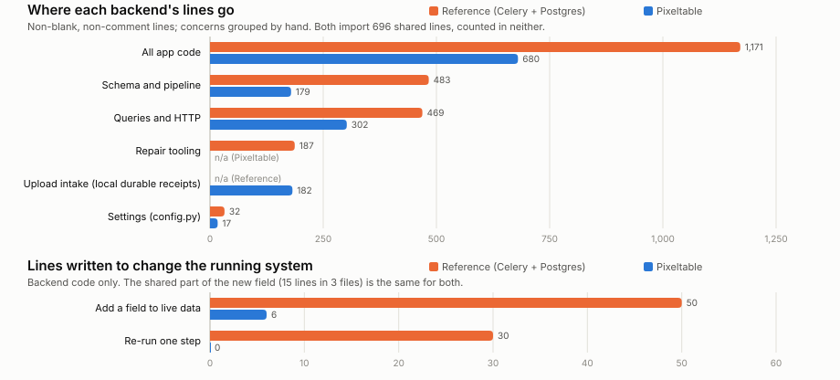
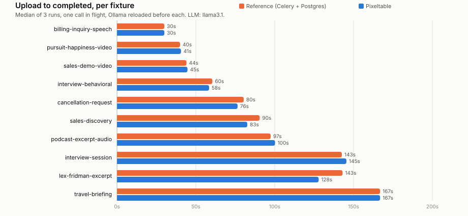
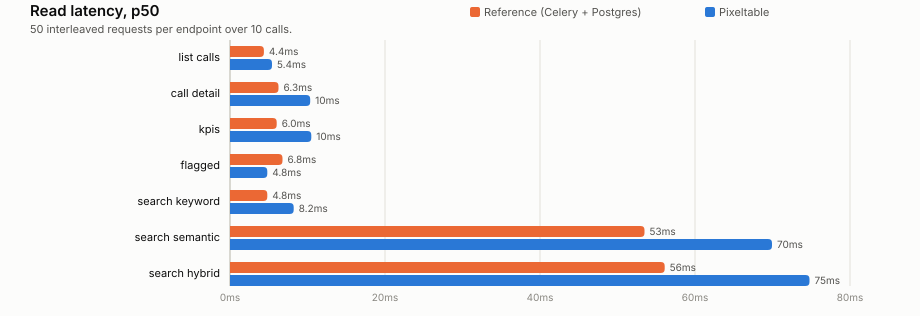

# Backend comparison and recorded results

Both implementations serve the same UI and REST contract. Source counts describe the current code; runtime and evolution measurements retain their original Pixeltable 0.7.11 environment. They are historical observations, not fresh measurements of the upgraded application.

Read the [methodology](METHODOLOGY.md) and [capability differences](CAPABILITY_PARITY.md) before interpreting the comparison. For the product demo, [start here](../README.md).



<!-- results:code -->
| Measured from source | Reference | Pixeltable |
|---|---|---|
| App code you maintain (lines) | 1,171 | 680 |
| Files | 24 | 4 |
| Project config files: pyproject.toml, alembic.ini (lines) | 59 | 20 |
| Tables | 3 | 2 |
| Views | n/a | 1 |
| Vector indexes | 1 | 1 |
| Migration files | 3 | n/a |
| Task-queue tasks | 4 | n/a |
| Status writes in pipeline code | 11 | n/a |
| Routes with a hand-written handler | 15 | 11 |
| Routes declared from a query | n/a | 1 |
| Orchestration hops | 50 | 17 |
| Processes to run (hand-classified) | 4 | 1 |
<!-- /results:code -->

The HTTP layer is where the two are closest: both hand-write handlers for the same REST contract. Most of the difference is behind it: the Reference writes the pipeline's orchestration, a status column it updates after each stage, its schema history, wrappers around each model, and tools to repair calls the pipeline left half-done. On Pixeltable that is the table definition below. [Where the lines go](../compare/WHY_PIXELTABLE.md#measured-from-source).

## Inspect the Pixeltable declarations

<!-- results:pipeline_code -->
```python
class Calls(TableModel, name="calls"):
    id = pxt.Column(type=pxt.UUID, primary_key=True)
    audio: pxt.Audio | None
    video: pxt.Video | None
    media_type: pxt.String
    call_date: pxt.Timestamp
    agent_id: pxt.String
    customer_id: pxt.String
    queue: pxt.String
    vertical: pxt.String
    original_filename: pxt.String

    extracted_audio = extract_audio(video, format="mp3")
    source_audio = f.pick_source_audio(audio, extracted_audio)
    diarized = transcribe(
        source_audio,
        model=config.WHISPERX_MODEL,
        diarize=True,
        num_speakers=2,
        diarization_model_name=config.WHISPERX_DIARIZATION_MODEL,
    )
    segments = f.extract_segments(diarized)
    transcript = f.flatten_transcript(segments)
    handle_time_sec = f.handle_time(segments)

    summary = f.parse_summary_content(transcript, ollama(f.chat_messages(vertical, transcript, "summary")))
    if config.ENRICHMENT_PROFILE == "core":
        action_items: pxt.Json | None
        sentiment: pxt.Json | None
        category: pxt.String | None
        qa_scorecard: pxt.Json | None
    else:
        action_items = f.parse_action_items_content(
            transcript, ollama(f.chat_messages(vertical, transcript, "action_items"))
        )
        sentiment = f.parse_sentiment_content(transcript, ollama(f.chat_messages(vertical, transcript, "sentiment")))
        category = f.parse_category_content(
            transcript, ollama(f.chat_messages(vertical, transcript, "category"), json=False)
        )
        qa_scorecard = f.parse_qa_content(transcript, ollama(f.chat_messages(vertical, transcript, "qa")))


class TranscriptSegments(
    TableModel,
    name="transcript_segments",
    base=Calls.where(Calls.segments != None),  # noqa: E711
    iterator=list_iterator(Calls.segments),
):
    __indexes__ = [pxt.EmbeddingIndex(text, embedding=EMBED, name="segments_embed")]  # type: ignore[name-defined]
```
<!-- /results:pipeline_code -->

`pxt schema update app.py call_center` creates the tables, and inserting a row computes every column, its segment rows and their embeddings. Pixeltable schedules the computed-column dependencies and records cell failures. The application keeps the upload and review contract; a failed cell keeps its error beside the other results.

## Optional full comparison

The comparison keeps all five enrichments and runs both implementations against the original fixtures and contract. Its source counts describe the full application, including the core lesson option; its runtime/evolution measurements remain historical 0.7.11 observations. See the [methodology](../compare/METHODOLOGY.md) for fairness and device-selection limits.

```bash
(cd backends/reference && uv sync --frozen)
./scripts/run_compare.sh                              # both APIs, one worker, two UIs and all Docker services
./scripts/run_compare.sh seed                         # RESET both comparison stores; ingest all ten fixtures
```

Reference UI: **http://localhost:5173**, API **:8001**. Pixeltable comparison UI: **http://localhost:5174**, API **:8000**. This comparison uses `data/pixeltable/` and `data/reference/`, separate from the lesson. **Seeding deletes existing comparison data and uploads.** Use dedicated demo data.

## Changing the running system

Two changes and one failure, run against both backends with the ten seeded calls in place, then reverted ([`compare/evolve/`](../compare/evolve/), [`scripts/bench_evolve.py`](../scripts/bench_evolve.py)): add an LLM field to calls already processed, re-run only the summary after a prompt change, and recover from Ollama going down mid-call.

<!-- results:evolve -->
|  | Reference | Pixeltable |
|---|---|---|
| **Add `topics` to live data** |  |  |
| Lines written (backend) | 50 | 6 |
| Files touched (backend) | 8 | 2 |
| Operator steps | alembic upgrade head: add the column (1s)<br>restart the API and the Celery worker (9s)<br>run the backfill task over every processed call (58s) | restart the pxt daemon (shared module changed) (2s)<br>pxt schema update: add the column, backfill every row (54s)<br>pxt service update: serve the new column (11s) |
| Wall time | 68s | 67s |
| Existing calls with topics (of 10) | 10 | 10 |
| New uploads get topics | yes | yes |
| **Re-run only the summary after a prompt change** |  |  |
| Lines written (backend) | 30 | 0 |
| Operator steps | restart the API and the Celery worker (9s)<br>run the re-summarize task over every processed call (92s) | restart the pxt daemon (shared module changed) (2s)<br>pxt recompute calls summary: one LLM call per row (109s)<br>pxt service restart: new uploads use the new prompt (9s) |
| Wall time | 101s | 120s |
| Summaries changed (of 10) | 10 | 10 |
| Transcripts untouched | 10 | 10 |
| Coaching comment still anchored | yes | yes |
| **Reference without new code: re-queue `process_call`** |  |  |
| Wall time | 722s |  |
| Transcripts untouched | 0 |  |
| Coaching comment still anchored | **no** |  |
| **Recover from an LLM outage during processing** |  |  |
| State after the outage | failed, 2 segments kept | failed, 2 segments kept |
| Where the error is recorded | the call's `status` and `error_message` | `errormsg` on `action_items`, `category`, `qa_scorecard`, `sentiment`, `summary` |
| Recovery code that had to exist | 80 lines (`resume_call.py`) | 0 lines |
| Operator steps | run the resume task written for this (resume_call.py) (26s) | pxt errors: which cells failed (0s)<br>pxt recompute summary --errors-only (5s)<br>pxt recompute action_items --errors-only (2s)<br>pxt recompute sentiment --errors-only (8s)<br>pxt recompute category --errors-only (2s)<br>pxt recompute qa_scorecard --errors-only (5s) |
| Wall time | 26s | 22s |
| Completed, transcript untouched | yes | yes |
| Searchable again | yes | yes |
<!-- /results:evolve -->

## Speed

Same machine, one call in flight, backends interleaved ([`scripts/benchmark.py`](../scripts/benchmark.py)).



<!-- results:pipeline -->
| Fixture (median seconds) | Reference | Pixeltable | Ref / Pxt |
|---|---|---|---|
| billing-inquiry-speech | 30.0 | 30.0 | 1.0x |
| pursuit-happiness-video | 40.0 | 40.6 | 1.0x |
| sales-demo-video | 44.1 | 44.7 | 1.0x |
| interview-behavioral | 60.5 | 58.4 | 1.0x |
| cancellation-request | 80.3 | 76.5 | 1.1x |
| sales-discovery | 90.5 | 82.7 | 1.1x |
| podcast-excerpt-audio | 97.4 | 100.2 | 1.0x |
| interview-session | 142.6 | 145.5 | 1.0x |
| lex-fridman-excerpt | 143.0 | 127.9 | 1.1x |
| travel-briefing | 166.8 | 166.8 | 1.0x |
| **All 10** | **895** | **873** | **1.0x** |

30 timed runs per backend; runs that did not complete: Reference 0, Pixeltable 0 (medians use completed runs; errors are in `benchmarks.json`).

Warm-up call (process coldness not verified): Reference 35.6s, Pixeltable 41.0s. Upload accepted in 50ms and 20ms (median).
<!-- /results:pipeline -->

Where the time goes, from the statuses the Reference commits (Pixeltable reports no stages; both run the same models):

<!-- results:stages -->
| Reference stage, median of 30 runs | Seconds | Share |
|---|---|---|
| Queued | 0.5 | 1% |
| Transcribe and diarize (WhisperX) | 25.4 | 30% |
| Five LLM enrichments | 59.3 | 70% |
| Embed segments | < 0.5 | - |
<!-- /results:stages -->



<!-- results:reads -->
| Endpoint | Reference p50 | Pixeltable p50 | Reference p95 | Pixeltable p95 |
|---|---|---|---|---|
| list calls | 4.38ms | 5.42ms | 7.15ms | 6.41ms |
| call detail | 6.26ms | 10.35ms | 8.16ms | 11.93ms |
| kpis | 6.03ms | 10.49ms | 7.83ms | 12.03ms |
| flagged | 6.78ms | 4.81ms | 8.44ms | 5.5ms |
| search keyword | 4.81ms | 8.22ms | 8.33ms | 9.97ms |
| search semantic | 53.49ms | 69.94ms | 73.47ms | 88.15ms |
| search hybrid | 56.09ms | 74.78ms | 61.84ms | 83.98ms |
<!-- /results:reads -->

In the full comparison profile, both backends make the same WhisperX and LLM calls, so most of the pipeline's time is the models'. Neither runs the five LLM calls concurrently: the Reference loops over them, and Pixeltable's built-in `ollama.chat` is a synchronous UDF, which its engine runs one at a time.

## Where the Reference is ahead

- **Progress.** It commits a status after each stage and lists a call as soon as it is uploaded. The Pixeltable receipt appears in detail and roster immediately as `processing`, but it does not expose individual model stages; the canonical row commits with all its computed columns.
- **Throughput.** Pixeltable's inserts into one table hold its lock for the whole computation and run one at a time. Celery runs as many calls as it has workers. Here both run one at a time.
- **Backfills.** The Reference's backfill task commits call by call. `pxt schema update` backfills a new column in one transaction, and one failing row rolls back the column.
- **Reads in the historical run.** Where Pixeltable's endpoints were hand-written, the Reference answered faster: building a Pixeltable query resolves the table once per selected expression. This app builds each select list once per process; semantic search, whose select list depends on the request, still pays that cost.
- **Familiarity.** Every part of it is a tool most backend engineers know.

The intake boundary has changed since the measured release. The Reference keeps its queued database record, but database commit and broker publish are separate, Redis persistence is not configured, and Celery uses early acknowledgement. The current Pixeltable app persists media and a SQLite receipt before acceptance and reconciles pending work on restart under one service writer. Failed work stays terminal for explicit recovery. Neither guarantee establishes exactly-once external model effects.

More tradeoffs: [compare/WHY_PIXELTABLE.md](../compare/WHY_PIXELTABLE.md#where-the-reference-is-ahead).

## Measure it

With both stacks up and seeded:

```bash
uv run python scripts/compare_all.py                     # parity and mutation gates
uv run python scripts/benchmark.py                       # timings
uv run python scripts/bench_evolve.py --full-reprocess   # new invocation report; re-seed afterwards
uv run python scripts/metrics.py && uv run python scripts/render_results.py
```

Every number above is written into this file by `render_results.py` from [`compare/results/`](../compare/results/); CI fails if they drift. The published run:

<!-- results:environment -->
Apple M4 Pro, 14 cores, 48 GB, Darwin 26.6.1; Python 3.12.7; Pixeltable 0.7.11, WhisperX 3.8.6, torch 2.8.0; Ollama 0.31.1 serving `llama3.1` (46e0c10c039e) in Docker (4 cpus, 8307830784 bytes). Pipeline measured 2026-09-28T20:34:30+00:00, reads 2026-09-28T22:24:37+00:00, at `b37a52a` with local changes.
<!-- /results:environment -->

Timing runs write new reports under `compare/reports/benchmark/`; `--output` selects a new file and refuses existing files before provider work. Partial timing runs contain only their current measurements. Evolution runs write new reports under `compare/reports/evolve/`, with setup identity and explicit status per attempted experiment. Partial and failed runs never relabel or replace the published `evolve.json`. Publishing new results requires an intentional review of a complete compatible run.

Source counts are refreshed when code changes. Runtime measurements require a fresh full run on both stacks before making a claim about the current release. The benchmark warms whichever service processes are already running; it does not prove a cold start. It verifies Ollama cache reset and fingerprints application source to avoid combining measurements from different dirty checkouts.

